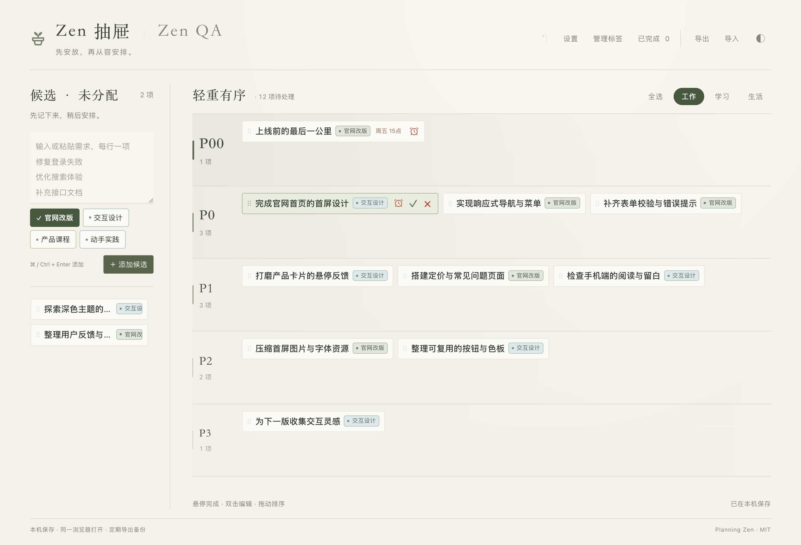
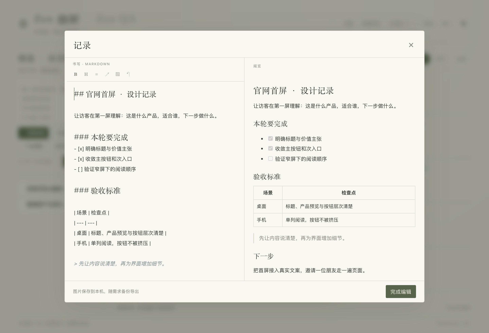
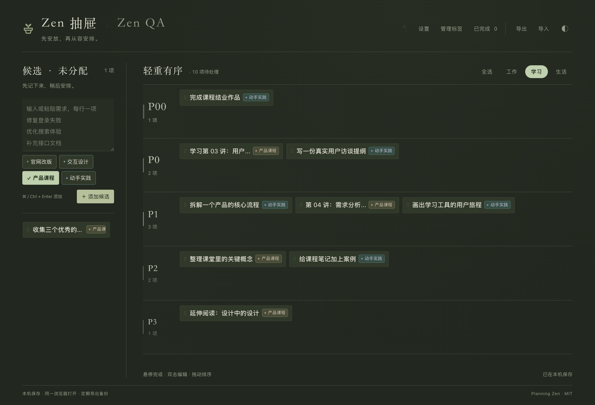
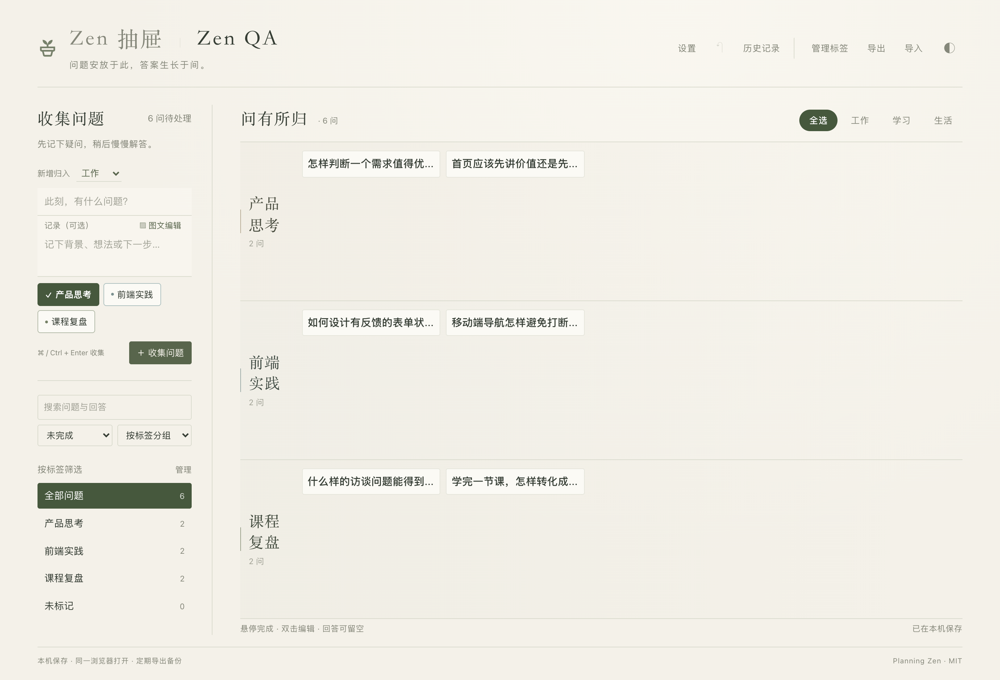
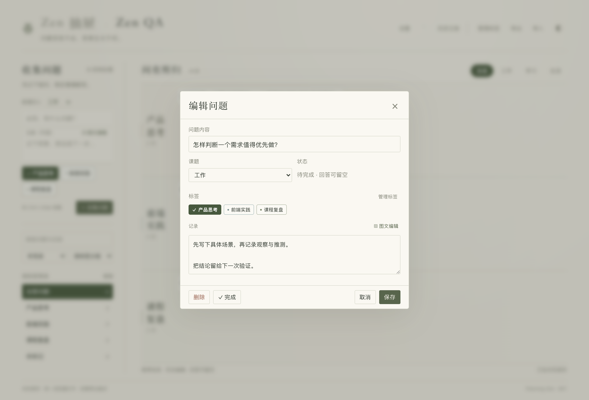

<div align="center">


# Zen 抽屉

**先安放，再从容安排。**

一款把待办、项目记录和问题笔记放在一起的 macOS 本地应用。  
把脑中的事情写下来，按轻重缓急放进抽屉，为值得思考的问题留下一页答案。

**macOS 13.1+ · Apple Silicon & Intel · 离线可用 · 无需注册**

[下载最新版](https://github.com/77Liu/zen-drawers/releases/latest) · [从这里开始](#三分钟开始使用) · [场景案例](#把它用在你的项目里) · [本地构建](#从源码构建)

</div>



> 图中均为专门编写的演示内容，展示当前 3.0.4 版本的实际界面。安装后的应用从空白记录开始。

## 留一张安静的桌面，给正在做的事

工作里的需求、学习中的练习、生活里临时想起的小事，常常一起涌进脑中。Zen 抽屉给它们一个简单的去处：左边先收集，右边再安排。你可以拖动一张卡片改变优先级，也可以打开它，把进展、资料和下一步写在一起。

遇到暂时没有答案的问题，就切到 **Zen QA**。先保存问题和背景，等有了观察、读完一篇文章或做完一次实践，再回来补上回答。

| Zen 抽屉 · 安排行动 | Zen QA · 整理思考 |
| --- | --- |
| 一次粘贴多条待办，每行一项 | 收集问题，补充文字与图片背景 |
| 在抽屉之间拖放，调整先后顺序 | 按标签分组，按课题和回答状态筛选 |
| 为任务添加标签、记录、文件与链接 | 用 Markdown 书写回答，实时预览 |
| 标记加急、设置加急时间、完成与恢复 | 搜索问题与回答，回看历史记录 |

## 把它用在你的项目里

### 01 / 做一个真正能交付的前端页面

从“做个官网”开始，把想法拆成可以完成的动作：首屏设计、响应式导航、表单校验、产品卡片、图片压缩。先把所有想法放进候选区，再将影响交付的事项放到靠前的抽屉。

上方的官网案例中，P0 放首屏、导航与表单，P1 放页面内容与交互打磨，P2 放性能和组件整理。“官网改版”“交互设计”两个标签让卡片保留各自的上下文。移入卡片即可看到加急、完成和红叉删除按钮，误删后可以立即撤销。

双击“完成官网首页的首屏设计”，在记录里写清楚本轮范围、验收标准和下一步。任务标题保持简洁，细节留在里面。



**可以照着开始：**

```text
完成官网首页的首屏设计
实现响应式导航与菜单
补齐表单校验与错误提示
打磨产品卡片的悬停反馈
检查手机端的阅读与留白
压缩首屏图片与字体资源
```

### 02 / 把一门产品课程，学成一个小作品

切换到“学习”，把课程章节和实践练习放在同一张桌面上。以“产品课程”标记知识输入，以“动手实践”标记自己的产出：学用户访谈，就写一份提纲；学需求取舍，就拆一个真实产品；最后让这些练习汇成结业作品。

深色模式使用低亮度的绿色与纸张般的层次，适合晚间整理。字体、字号和重点字重都可以在设置中调整。



| 一次学习 | 一个可留下的产出 |
| --- | --- |
| 用户访谈 | 一份可实际使用的访谈提纲 |
| 需求分析与取舍 | 一个产品的核心流程拆解 |
| 用户旅程 | 一张学习工具的体验路径 |
| 课程复盘 | 一份有例子、有疑问的课程记录 |

这些是使用建议，课程与练习需要自行添加。

### 03 / 给暂时答不出的问题，一个可以回来的地方

“怎样判断一个需求值得优先做？”“首页先讲价值，还是先展示功能？”把这些问题放进 Zen QA，按“产品思考”“前端实践”“课程复盘”整理。

问题按标签聚合，组内只展示问题卡片。双击卡片即可编辑，底部保留操作提示。问题可以先只有一句话，也可以带上截图与背景。想清楚之后，用 Markdown 写下自己的回答，保存后标记为已完成；以后通过搜索或“历史记录”重新找到它。回答也可以留空，直接完成；完成状态会随备份一起保存。



双击打开的问题编辑页，与任务编辑使用同一套标题、课题、标签、记录和按钮样式。可以只保存问题，也可以直接点击“✓ 完成”。



## 三分钟开始使用

1. 从 [Releases](https://github.com/77Liu/zen-drawers/releases/latest) 下载 `.dmg`，打开后将 **Zen 抽屉.app** 拖入“应用程序”。
2. 打开应用，在左侧输入事情，每行一项，按 `⌘ + Enter` 添加。
3. 把卡片拖进抽屉。默认从 P00 到 P3，也可以在“设置”中修改名称、颜色和顺序。
4. 双击卡片补充记录、标签、附件或链接；完成时点对钩，删除时点红叉。
5. 有问题要慢慢想，就切到 **Zen QA**；定期分别导出抽屉与 QA，保留备份。

当前构建使用临时签名，尚未完成苹果公证。首次打开如遇开发者验证提示，请参阅 [安装说明](macOS/安装说明.md)。

<details>
<summary><strong>常用操作，一眼查到</strong></summary>

| 想做的事 | 操作 |
| --- | --- |
| 批量收集待办 | 每行一项，点击“添加候选”或按 `⌘ + Enter` |
| 调整优先级与顺序 | 拖动卡片到目标抽屉或卡片之间 |
| 编辑任务 | 双击卡片；键盘聚焦卡片后按回车 |
| 完成 / 删除 | 悬停后点击 `✓` / 红色 `×` |
| 撤销最近的修改 | 点击工具栏 `↶`；抽屉支持 `⌘ + Z` |
| 找回完成的任务 | 打开“已完成”，点击“恢复” |
| 选择多个标签 | 点击标签；实色底与勾选标记表示已选，再点取消 |
| 调整阅读外观 | “设置”中选择字体、字号与重点字重 |
| 切换明暗主题 | 点击右上角 `◐` |

</details>

## 记录留在自己的 Mac 上

安装版使用 **Cocoa 独立窗口 + 系统 WebKit + 内置 Swift 本机服务**。使用者无需安装 Chrome、Python、Node.js 或 Xcode，核心记录与编辑功能断网可用。打开外部链接、下载网络图片时需要网络连接。

程序和数据分开保存：更新时替换“应用程序”里的 App，已有记录仍保留在当前用户的 `~/.zen`。

```text
~/.zen/
├── state.json     待办、QA、标签、回答、草稿与设置
├── files/         图片与文件附件
├── files.json     附件类型信息
├── backups/       文本状态快照
└── window.json    窗口尺寸
```

完整迁移到另一台 Mac 时，先退出应用，再复制整个 `.zen` 目录；日常备份可以使用两个页面各自的导出功能，备份会带上对应附件。`backups/` 内的状态快照没有单独复制附件。

App 运行期间，可从菜单“文件 → 在浏览器打开”访问同一份本机数据。服务仅监听回环地址，退出 App 后停止；目前采用本机保存与手动导入导出，不提供跨设备云同步或多人协作。直接打开 HTML 的独立网页模式使用浏览器存储，与安装版的数据位置不同。

## 从源码构建

构建需要 macOS 和 Xcode 命令行工具。应用资源与第三方编辑器已保存在仓库中。

```bash
git clone https://github.com/77Liu/zen-drawers.git
cd zen-drawers
bash macOS/build.sh 3.0.4
```

在 `dist/` 中取得 Universal DMG、ZIP 和 SHA-256 校验文件。本机若已安装 App，先正常退出应用；打包成功后会同步更新 `/Applications/Zen 抽屉.app`，程序坞继续使用原入口。设置 `ZEN_INSTALL_LOCAL=0` 可仅打包，已有安装包也可通过 `bash macOS/install-local.sh 3.0.4` 安装。构建脚本仅打包运行所需资源，不包含个人记录、开发截图或本机备份。

| 目录 / 文件 | 内容 |
| --- | --- |
| `Zen抽屉.html` | 抽屉界面、任务交互与页面入口 |
| `assets/` | 卡片布局、标签、图文编辑、外观与本地存储模块 |
| `assets/vendor/` | EasyMDE、DOMPurify 与第三方许可 |
| `macOS/` | 原生窗口、本机服务、数据存储及打包脚本 |
| `docs/images/` | 使用演示数据制作的产品截图 |

更多数据存储、签名与公证说明见 [原生应用使用与打包](macOS/使用说明.md)。

## 3.0.4 更新

- **两页对齐：** QA 与抽屉共用侧栏、标题、卡片分组和关键分隔线，搜索筛选收进侧栏。
- **回答可留空：** 完成状态独立于回答正文，支持直接完成、撤销、历史查询及备份恢复。
- **问题列表更简洁：** 分组内隐藏重复标签、修改标签与编辑链接，双击即可进入编辑。
- **编辑页统一：** 复用任务编辑的字段、字号、间距与操作栏；保留 Markdown 和本地图片能力。
- 保留 3.0.3 的红叉删除与标签高反差选中样式。

## 致谢

抽屉交互基于 [Planning Zen](https://github.com/f3d0rov/planning-zen) 发展。Markdown 编辑使用 [EasyMDE](https://github.com/Ionaru/easy-markdown-editor)，HTML 清理使用 [DOMPurify](https://github.com/cure53/DOMPurify)。Planning Zen 的 MIT 许可见 [LICENSE](LICENSE)，第三方许可保留在 [`assets/vendor/`](assets/vendor/)。
