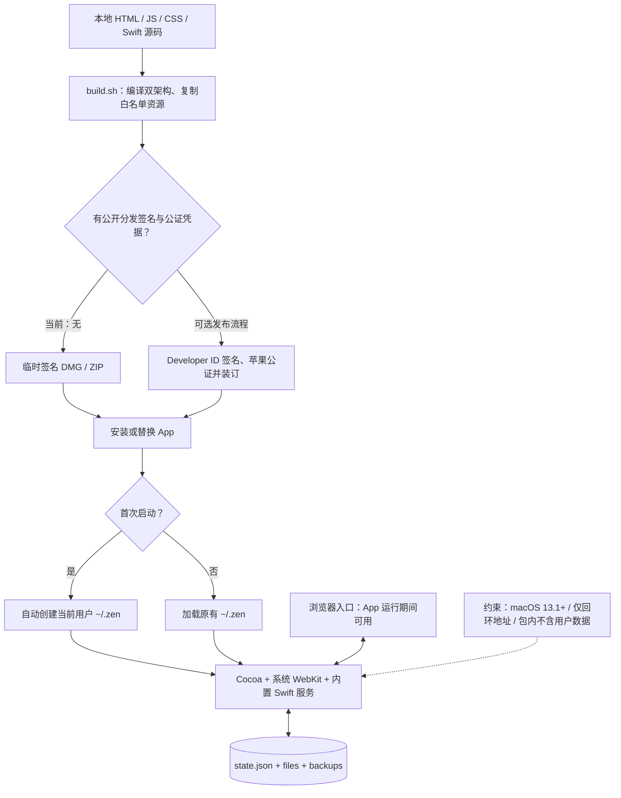

# Zen 原生应用：使用与打包

当前实现：Cocoa 独立窗口 + 系统 WebKit + App 内置 Swift 本机服务。接收者无需安装 Chrome、Python、Node 或 Xcode。系统要求 macOS 13.1+，同一个包包含 Apple Silicon 和 Intel 两种架构。

## 安装与更新

把 `dist/Zen抽屉-版本号-macOS-universal.dmg` 发给别人。对方打开 DMG，把 App 拖入 Applications，然后启动。首次启动自动创建当前用户的 `~/.zen`；安装包不带制作者的数据，也没有用户名、开发机器路径或 Chrome 配置。

更新时退出 Zen，用新版 App 替换旧版即可。程序在 App 内，数据在用户目录，互不覆盖。不要把整个项目文件夹当作分享包，项目的 `work` 中保留了开发截图和旧版备份。

本机当前构建为临时签名版本，未做苹果公证，其他 Mac 首次打开可能要求在「系统设置 → 隐私与安全性」中确认。要做到正常公开分发且不出现未知开发者提示，需要 Developer ID Application 证书及苹果公证；Apple Development 证书不等于公开分发证书。

## 本机更新与程序坞

每次本机更新沿用 `/Applications/Zen 抽屉.app`，程序坞与桌面快捷方式无需重建。打包前先正常退出应用，默认打包流程会同步更新已有安装。仅生成安装包时设置 `ZEN_INSTALL_LOCAL=0`；单独安装已生成的版本可运行 `bash macOS/install-local.sh 3.0.3`，然后从原入口重新启动。安装器保留 App 根目录，以延续程序坞书签；用户数据不参与替换。

## 数据目录

```text
~/.zen/
  state.json     # 待办、完成记录、QA、标签、回答、草稿、外观设置
  files/         # 图片、文件附件，按稳定 ID 保存
  files.json     # 附件 MIME 类型
  backups/       # 首次迁移与退出时的文本状态快照
  window.json    # 窗口尺寸
```

App 的 WebKit 采用内存网站数据容器，业务记录和二进制附件通过内置接口直接保存在 `.zen`，不依赖浏览器缓存。状态文件用原子替换写入；目录权限 700、业务数据文件权限 600。

退出 App 后复制整个 `.zen`，即可迁移到另一台 Mac 的同名目录。`backups` 中的状态快照不复制一份附件；完整搬迁应复制整个 `.zen`，或分别使用抽屉、QA 的「导出」。

App 运行时，「文件 → 在浏览器打开」会打开 [本机入口](http://127.0.0.1:19763/)。所有浏览器、配置与 App 均读写同一个 `.zen`，不再要求同一 Chrome 配置。关闭 App 后服务停止；重开后浏览器可以刷新继续用。服务只监听回环地址，不对局域网或外网开放。

## 一条命令打包

在项目文件夹运行：

```bash
bash macOS/build.sh 3.0.3
```

构建者需要 Xcode 命令行编译工具；接收者不需要。命令编译 Universal Binary、复制白名单中的网页资源、生成图标、签名并输出 DMG、ZIP 和 SHA-256 文件。不会读取或打包 `.zen`、Chrome 数据、`work`、用户备份或本机服务配置。

输出位于 `dist/`：

- `Zen抽屉-版本号-macOS-universal.dmg`：推荐分享的安装包。
- `Zen抽屉-版本号-macOS-universal.zip`：同一 App 的压缩包。
- `*.dmg.sha256`：安装包校验值。

打包完成会清理临时 App 和图标目录，避免系统搜索出现重复应用。安装后的唯一入口为 `/Applications/Zen 抽屉.app`，桌面快捷方式指向同一个程序。

有 Developer ID 及已配置的钥匙串公证凭据后，同一脚本支持：

```bash
ZEN_SIGN_IDENTITY='Developer ID Application: 你的证书名称' \
ZEN_NOTARY_PROFILE='你的钥匙串公证配置名称' \
bash macOS/build.sh 3.0.3
```

证书和公证凭据不写进项目或安装包。`macOS/legacy` 保留了旧版 Chrome/Python 迁移工具，不会随原生包分发，也不应再用它部署新版本。

## 已实现的数据与更新链路



最低系统版本设为 macOS 13.1，以使用内置新版 WebKit 的颜色混合等能力，避免安装后还需升级浏览器；相关能力见 [WebKit 官方发布说明](https://webkit.org/blog/13966/webkit-features-in-safari-16-4/)。

## Markdown 记录与本地图片

抽屉「记录」与 QA「记录」均支持 Markdown，可用「图文编辑」查看实时预览。粘贴截图、网页图片或 Markdown 图片后，图片写入 `~/.zen/files`，正文使用稳定的 `zen-image:` 引用。网络图片通过原生服务下载，保存记录时也会转换手写的网络图片引用；下载失败会提示并保留编辑内容。普通超链接仍保留原地址。抽屉图片列入该需求的附件；QA 图片列入 QA 图片目录，均随对应 JSON 备份导出。
